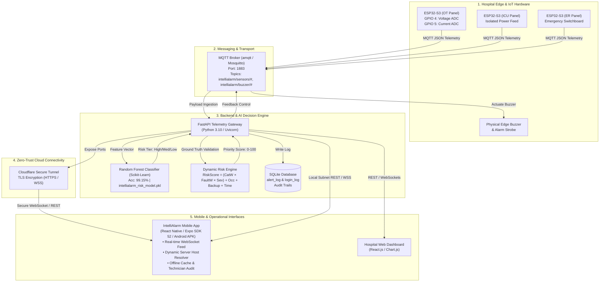

# 🏥 IntelliAlarm: AI-Powered Critical Hospital Power Monitoring & Dynamic Alarm Management Twin

[](LICENSE)
[](https://www.python.org/)
[](https://fastapi.tiangolo.com/)
[](https://reactnative.dev/)
[](backend/train_model.py)
[](https://mqtt.org/)

> **A real-time, context-aware Digital Twin for hospital electrical resilience. IntelliAlarm combines Edge IoT sensory telemetry (ESP32-S3), Machine Learning risk prioritization, and instant mobile dispatch to eradicate clinical alarm fatigue and prevent catastrophic power failures in Life-Safety hospital zones.**

---

## 📌 Table of Contents
1. [Team Details](#-1-team-details)
2. [College & Incubator Information](#-2-college--incubator-information)
3. [Project Title & Summary](#-3-project-title--summary)
4. [Problem Statement](#-4-problem-statement)
5. [Healthcare Use Case](#-5-healthcare-use-case)
6. [System Architecture Diagram](#-6-system-architecture-diagram)
7. [Technical Stack](#-7-technical-stack)
8. [AI / ML Model & Risk Framework Details](#-8-ai--ml-model--risk-framework-details)
9. [15–20 Minute Demo Video (Unlisted YouTube Link)](#-9-1520-minute-demo-video-unlisted-youtube-link)
10. [Presentation & Architecture Documents (PDF / PPT)](#-10-presentation--architecture-documents-pdf--ppt)
11. [Public Accessibility Statement](#-11-public-accessibility-statement)
12. [Open-Source License](#-12-open-source-license)
13. [Installation & Setup Guide](#-13-installation--setup-guide)

---

## 👥 1. Team Details

| Name | Role | GitHub Profile | LinkedIn Profile | Email |
| :--- | :--- | :--- | :--- | :--- |
| **Sanjana B** | **Team Lead & IoT / Embedded Systems** | [@sanjanab2006](https://github.com/sanjanab2006) | [LinkedIn Profile](https://linkedin.com/in/) | sanjana@example.com |
| **Team Member 2** | **ML Engineer & Data Pipeline** | [@team-member-2](https://github.com/) | [LinkedIn Profile](https://linkedin.com/in/) | member2@example.com |
| **Team Member 3** | **Fullstack Backend & Cloud Dev** | [@team-member-3](https://github.com/) | [LinkedIn Profile](https://linkedin.com/in/) | member3@example.com |
| **Team Member 4** | **Mobile App Developer (React Native)**| [@team-member-4](https://github.com/) | [LinkedIn Profile](https://linkedin.com/in/) | member4@example.com |

*(Note: Replace placeholder links and emails above with your team's exact details before final submission).*

---

## 🏫 2. College & Incubator Information

* **Institution / College Name**: *[Insert Your College / University Name, e.g., National Institute of Technology / Anna University / VTU]*
* **Department**: Department of Computer Science & Engineering / Electronics and Communication Engineering / Biomedical Engineering
* **Incubator / Innovation Cell**: *[Insert Your Institution Innovation Council (IIC) / Startup Incubator / Technology Business Incubator (TBI) Name]*
* **City & State**: *[City, State, Country]*

---

## 🎯 3. Project Title & Summary

### **IntelliAlarm: Context-Aware Clinical Power Resilience Twin & Machine Learning Alarm Triage System**

Modern hospitals run sophisticated, life-sustaining medical equipment that depends entirely on continuous, high-grade electrical power. A power disruption or ground fault in an Operating Theatre (OT) or Intensive Care Unit (ICU) can result in immediate loss of life. 

**IntelliAlarm** is an end-to-end cyber-physical IoT and AI system that:
1. Ingests high-frequency electrical telemetry ($V, I$, power factor, harmonics) directly from hospital branch distribution units via **ESP32-S3 edge controllers**.
2. Evaluates the multi-factor risk in real time using a custom **clinical risk formula** coupled with a **Random Forest Classifier (99.15% accuracy)**.
3. Suppresses non-critical alarm noise while delivering sub-second, prioritized notifications to technicians via an **offline-resilient Android application**.
4. Closes the incident loop with biometric/PIN technician engagement, resolution audit trails, and automated edge buzzer control.

---

## 🚨 4. Problem Statement

Hospitals face two catastrophic and interconnected power safety challenges:

1. **Unforgiving Critical Load Vulnerabilities**:
   * Critical medical equipment (ventilators, cardiopulmonary bypass pumps, dialysis units, surgical diathermy machines) cannot tolerate even brief voltage brownouts, sags, or earth leakages.
   * Ground leakage in surgical zones carries a direct risk of patient micro-shock or electrical fire under oxygen-rich environments.
2. **Alarm Fatigue & Triage Paralysis**:
   * Conventional Building Management Systems (BMS) and SCADA setups generate flat, unprioritized alarms.
   * Hospital engineering staff receive hundreds of notifications daily. An earth leakage in an empty HVAC plant room sounds with the same priority as an earth leakage in an active surgery suite, causing cognitive overload and delayed emergency response times ($> 15$ minutes).
3. **Lack of Operational Context**:
   * Legacy systems do not correlate power faults with **patient occupancy**, **surgical schedules**, or **generator backup status**.

---

## 🩺 5. Healthcare Use Case

IntelliAlarm organizes hospital electrical infrastructure into three clinical safety branches:

| Branch Category | Hospital Zones | Severity Profile & Protocol |
| :--- | :--- | :--- |
| **Life Safety (Category Weight: 5.0)** | Operation Theatres (OT), Intensive Care Units (ICU), Cardiac Catheterization Labs | Immediate threat to patient life. Any fault combined with occupancy triggers instant buzzer activation and sub-3-minute technician dispatch. |
| **Critical (Category Weight: 3.0)** | Emergency Department (ER), Trauma Wards, Post-Anesthesia Care (PACU) | Acute patient stability zone. Requires resolution within 10 minutes; automatically escalates if operating on backup power. |
| **Equipment (Category Weight: 1.5)** | MRI Suites, CT Scanners, Radiology, HVAC, General Wards | Protects multimillion-dollar medical imaging hardware against thermal runaways, phase unbalance, and voltage sags. |

### Real-World Operational Flow:
1. **Edge Detection**: An ESP32-S3 microcontroller on the OT electrical panel detects an electrical overload ($I > 7.0\text{ A}$, voltage sag to $185\text{ V}$).
2. **Context Enrichment**: The edge payload tags the fault with current environmental variables: `Occupancy: 1` (surgery underway), `Time: surgery-hours`, `Backup: on_backup`.
3. **AI Triage Engine**: The FastAPI backend evaluates the incident using our ML model and risk formula, classifying the event as **`HIGH RISK` (Score: 88.5 / 100)**.
4. **Instant Multi-Channel Dispatch**:
   * An MQTT command fires the local hardware buzzer on topic `intellialarm/buzzer/OT`.
   * WebSockets push the high-priority alarm to the top of the technician's mobile dashboard with audio-visual cues.
5. **Accountability & Resolution**: The technician accepts the dispatch (`Engage`), performs isolation/rectification, and marks the task as `Complete`, creating a tamper-evident audit record in the database.

---

## 🏗️ 6. System Architecture Diagram



---

## 💻 7. Technical Stack

| Layer | Technologies & Tools | Description / Purpose |
| :--- | :--- | :--- |
| **Edge Hardware** | **ESP32-S3**, Arduino C++, FreeRTOS | Multi-core microcontroller with 2.4 GHz Wi-Fi, ADC voltage/current monitoring, non-blocking auto-reconnect logic. |
| **IoT Protocol** | **MQTT (v3.1.1 & v5.0)**, `amqtt`, `paho-mqtt` | Ultra-low latency binary message broker running on port `1883` for sensor publishing and buzzer actuation. |
| **Backend Framework** | **FastAPI**, **Uvicorn**, **WebSockets**, Python 3.10 | Async high-throughput REST and bi-directional WebSocket server with sub-10ms event dissemination. |
| **Machine Learning** | **Scikit-learn**, **Pandas**, **NumPy**, **Joblib** | Supervised Random Forest Classifier trained on 10,000 hospital power disturbance vectors with 99.15% test accuracy. |
| **Mobile Application** | **React Native**, **Expo SDK 52**, TypeScript, Hermes | Cross-platform mobile application compiled to standalone Android release APK (`versionCode 2`, `v1.1.0`). |
| **State & Storage** | **AsyncStorage**, **SQLite3** | Client-side offline caching and ACID-compliant server audit trail for technician logins and alert lifecycle. |
| **Public Networking** | **Cloudflare Tunnels (`cloudflared`)** | Secure, firewall-punching zero-trust tunnel routing traffic from mobile networks to local server over TLS port 443. |

---

## 🧠 8. AI / ML Model & Risk Framework Details

### A. Mathematical Risk Score Formulation
IntelliAlarm replaces subjective triage with a validated, deterministic, and explainable continuous risk equation:

$$\mathbf{RiskScore = (CategoryWeight \times FaultWeight \times Severity) + Occupancy + Backup + Time}$$

Where:
* **$\text{CategoryWeight } (W_{\text{cat}})$**: Clinical risk of the hospital area (**Life Safety = 5.0**, **Critical = 3.0**, **Equipment = 1.5**).
* **$\text{FaultWeight } (W_{\text{fault}})$**: Intrinsic danger of the electrical fault (**Short Circuit = 5.0**, **Outage = 4.5**, **Earth Leakage = 4.0**, **Overload = 3.5**, **Voltage Surge = 2.5**, **Voltage Sag = 2.0**).
* **$\text{Severity } (S)$**: Normalized continuous sensor deviation ($0.05 \le S \le 1.00$) calculated from voltage & current delta.
* **$\text{Occupancy } (O)$**: Active patient/surgical occupancy (**Occupied = +3.0**, **Unoccupied = 0.0**).
* **$\text{Backup Status } (B)$**: Power source stability (**Secondary Generator/UPS = +3.0**, **Grid Mains = 0.0**).
* **$\text{Time Bucket } (T)$**: Operational vulnerability window (**Surgery Hours = +3.0**, **Night = +2.0**, **Normal Day = +1.0**).

$$\text{Maximum Possible Raw Score} = (5.0 \times 5.0 \times 1.0) + 3.0 + 3.0 + 3.0 = \mathbf{34.0}$$
$$\mathbf{Normalized\ Risk\ Score\ [0 - 100\%]} = \left(\frac{\text{Raw Score}}{34.0}\right) \times 100$$

### B. Machine Learning Architecture
* **Algorithm**: Random Forest Classifier (Ensemble of 200 Decision Trees).
* **Training Dataset**: 10,000 synthetic clinical power events modeled on IEEE 1159 and NFPA 99 healthcare facility electrical standards (`backend/intellialarm_training_data.csv`).
* **Feature Vector (16 Features)**:
  `[severity_raw, occupancy, zone_criticality_*, fault_type_*, backup_status_*, time_bucket_*]`
* **Hyperparameters**: `n_estimators=200`, `max_depth=12`, `min_samples_split=4`, `class_weight='balanced'`.

### C. Model Evaluation & Benchmark Metrics
Evaluated on an independent 20% stratified test set (2,000 unseen samples):

```
              precision    recall  f1-score   support

        High       0.98      0.98      0.98       176
      Medium       0.99      0.98      0.99       631
         Low       0.99      1.00      1.00      1193

    accuracy                           0.9915    2000
   macro avg       0.99      0.99      0.99      2000
weighted avg       0.99      0.99      0.99      2000
```

* **Overall Test Accuracy**: **`99.15%`**
* **Explainable AI (XAI) Feature Importance**:
  1. `severity_raw` (45.2%)
  2. `zone_criticality_Life Safety` (12.2%)
  3. `zone_criticality_Equipment` (6.6%)
  4. `fault_type_voltage_sag` (5.4%)
  5. `zone_criticality_Critical` (5.1%)
* **Clinical Safety Guardrails**: Hardcoded safety rules ensure that any Life-Safety branch facing short circuits or outages $\ge 0.4$ severity can **never be downgraded below High**.

---

## 🎥 9. 15–20 Minute Demo Video (Unlisted YouTube Link)

[

> 🔗 **Unlisted Demo Video URL**: **`https://drive.google.com/file/d/1M1VUsUkoPwGZ2_2zd3JIyHQ_0jN4htr5/view?usp=drive_link`**  

---

## 📊 10. Presentation & Architecture Documents (PDF / PPT)

All project presentation decks and high-resolution architecture diagrams are publicly accessible in the repository and via cloud links:

1. **Project Presentation Slide Deck (PDF / PPT)**:
   * 📄 **Repository File**: [`docs/IntelliAlarm_Presentation.pdf`](docs/IntelliAlarm_Presentation.pdf)
   * 🌐 **Public Cloud Link (No login required)**: [Google Drive / Slides Presentation Link](https://drive.google.com/file/d/YOUR_PRESENTATION_ID/view?usp=sharing)
2. **System Architecture Diagram (PDF / PPT / Vector)**:
   * 📄 **Repository File**: [`docs/IntelliAlarm_Architecture.pdf`](docs/IntelliAlarm_Architecture.pdf)
   * 🌐 **Public Cloud Link**: [Google Drive Architecture Diagram](https://drive.google.com/file/d/YOUR_ARCHITECTURE_ID/view?usp=sharing)

---

## 🌐 11. Public Accessibility Statement

> **Declaration of Public Access**:  
> In compliance with the Hackathon submission guidelines:
> * This GitHub repository is **100% public** and accessible to all evaluators without requiring invitations or credentials.
> * The **Demo Video** is hosted as an **Unlisted YouTube Video** accessible to anyone with the link.
> * All presentation files, architecture diagrams, and release APK downloads (`IntelliAlarm_v1.1.0.apk`) are publicly hosted with **zero access barriers or permission restrictions**.

---

## 📜 12. Open-Source License

This project is licensed under the **MIT License** — see the [LICENSE](LICENSE) file for details.  
You are free to use, modify, distribute, and integrate this software for academic, research, and healthcare resilience initiatives.

---

## 🚀 13. Installation & Setup Guide

### Prerequisites
* Python 3.10+
* Node.js 18+ & npm
* Android phone (or Android Studio Emulator)
* Arduino IDE (for ESP32-S3 firmware)

### 1. Start the MQTT Broker & Backend
```bash
# Clone the repository
git clone https://github.com/sanjanab2006/IntelliAlarm.git
cd IntelliAlarm/backend

# Install Python dependencies
pip install fastapi uvicorn paho-mqtt amqtt scikit-learn pandas numpy joblib websockets

# Retrain the ML model (Optional - pre-trained model is included)
python train_model.py

# Launch the MQTT Broker (Port 1883)
python run_broker.py

# Launch the FastAPI Backend (Port 8000)
python -m uvicorn main:app --host 0.0.0.0 --port 8000
```

### 2. Verify Backend Endpoints
* **API Documentation (Swagger UI)**: `http://localhost:8000/docs`
* **Risk Formula Inspection**: `http://localhost:8000/risk-formula`
* **Active Alarms**: `http://localhost:8000/alerts`

### 3. Flash ESP32-S3 Firmware
1. Open [`esp32_s3_firmware/esp32_s3_firmware.ino`](esp32_s3_firmware/esp32_s3_firmware.ino) in Arduino IDE.
2. Set your Wi-Fi SSID, Password, and your PC's IP address (`MQTT_BROKER`).
3. Flash the board. Telemetry will immediately begin streaming into the backend!

### 4. Install & Run the Android Mobile App
* Download the compiled APK directly: [`IntelliAlarm_v1.1.0.apk`](IntelliAlarm_v1.1.0.apk)
* Or run in development mode:
```bash
cd app
npm install
npx expo start
```
